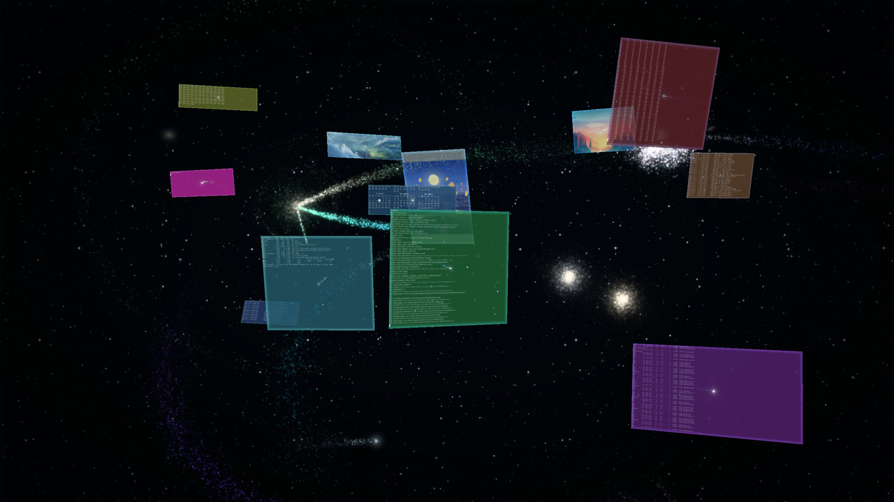
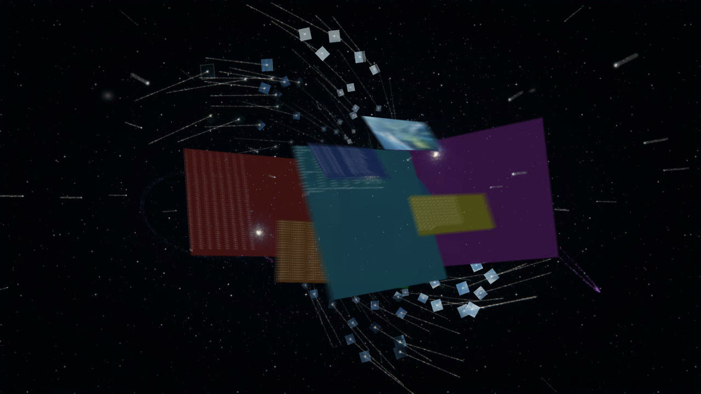
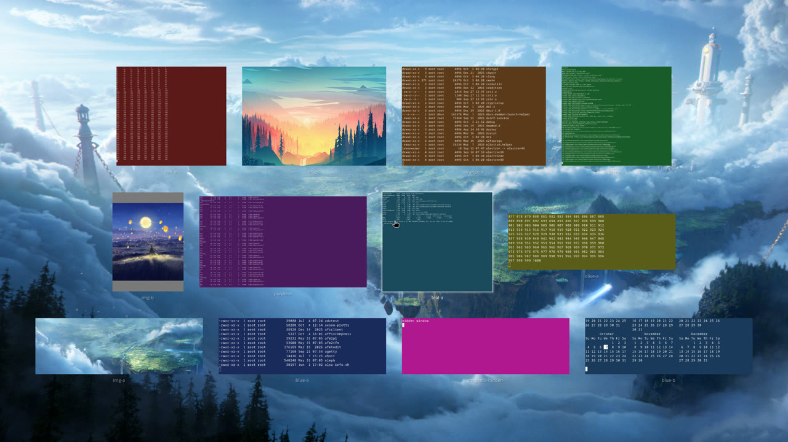

# dwm2

我在 Arch Linux 上自用的一套 dwm 桌面环境。窗口管理器、终端、合成器、锁屏、壁纸、状态栏和各种脚本都在这一个仓库里。新电脑装好最小 Arch 后，克隆仓库运行 `./setup.sh`，重启就能进入一模一样的桌面。

dwm 本体加了不少东西，最大的是 **Super+Z 3D 工作空间星系**：所有 tag 和窗口变成一个用 OpenGL 渲染的三维星系群，可以在里面浏览、搜索、切换窗口。



| 开场：桌面碎成星尘被吸进中心 | Super+A 窗口总览 |
|---|---|
|  |  |

<sub>截图来自 `dwm/tests/galaxy/` 的测试会话（Xvfb 软件渲染，测试窗口是彩色 xterm），真机效果更细腻。</sub>

## 特色

- **Super+Z 星系**：每个 tag 是一颗恒星，窗口是绕它公转的截图卡片。开场有三套随机轮换；驻留时镜头自动巡游；打字可以按标题过滤，点卡片就落到那个窗口。开关窗口、收到通知会变成新星、流星、彗星。
- **Super+A 窗口总览**：窗口从原位置飞进网格，可以打字过滤，选中后无缝落位。
- **Super+Shift+R 原地重启**：自动编译安装 dwm 并原地重启，窗口和 tag 都保留；编译失败时只弹通知，旧的 dwm 不受影响。
- **壁纸**：静态图片轮换、视频壁纸、Wallpaper Engine 场景壁纸，切换时用 GPU 播放转场动画。
- **Super+P 菜单**：动态/静态壁纸、省电模式（拔电自动打开）、勿扰、护眼、暂停自动锁屏、显示器布局和缩放。
- **多显示器**：插拔自动套用上次的布局，两块屏各自设缩放。
- **远程桌面**：Sunshine + Moonlight，Tailscale 提供固定 IP；x11vnc 备用。
- **可复现**：
  - 包清单、`/etc` 配置、个人配置全在仓库里，`./setup.sh` 一键装好。
  - `./setup.sh check` 体检。
  - 按显卡和硬件自动适配。

## 快速安装

需要一个装好的最小 Arch（base、linux、引导、联网、带 sudo 的普通用户），不需要装桌面环境：

```sh
sudo pacman -S --needed git
git clone https://github.com/DayDaySpeed/dwm2.git ~/projs/dwm2 && cd ~/projs/dwm2
./setup.sh          # 不装 Chrome / VSCode / Steam 等应用: ./setup.sh --no-apps
```

重启后自动登录并进入桌面。详细步骤、过程中的提示、需要手动完成的事见 [教程 1：安装](docs/tutorials/01-install.md)。

## 文档

从 [文档首页](docs/README.md) 开始。

**教程**（按步骤做）

| | |
|---|---|
| [1. 安装](docs/tutorials/01-install.md) | 从最小 Arch 到进入桌面 |
| [2. 快速上手](docs/tutorials/02-quickstart.md) | 基本概念和最常用的操作 |
| [3. 自定义](docs/tutorials/03-customize.md) | 快捷键、窗口规则、状态栏模块、本机配置、安装清单 |
| [4. 壁纸](docs/tutorials/04-wallpaper.md) | 三种壁纸、加自己的文件、Wallpaper Engine、转场 |
| [5. 多显示器](docs/tutorials/05-monitors.md) | 布局、缩放、焦点、清晰度取舍 |
| [6. 排错](docs/tutorials/06-troubleshooting.md) | check、日志、常见问题 |
| [7. 二次开发](docs/tutorials/07-development.md) | 启动链、改 dwm 源码、测试会话、扩展点 |

**手册**（查阅）：[dwm](docs/manual/dwm.md) · [星系](docs/manual/galaxy.md) · [终端](docs/manual/terminal.md) · [picom](docs/manual/picom.md) · [rofi](docs/manual/rofi.md) · [通知](docs/manual/notifications.md) · [锁屏与截图](docs/manual/lock-screenshot.md) · [远程桌面](docs/manual/remote-desktop.md)

## 目录结构

```
setup.sh       安装入口: bootstrap / deps / system / link / build / services / check
packages/      包清单: core (桌面必需)、apps (应用)、intel / amd / nvidia (按显卡追加), -aur 结尾的走 yay
system/        /etc 配置模板: tty1 自动登录、省电免密 sudo、NumLock、NVIDIA modeset
home/          个人配置: zsh、starship、kitty、fcitx5 (Rime 雾凇拼音 + 万象语法模型)、flameshot、GTK / Electron 缩放、sni-watcher
config/        桌面配置: dwm.h st.h tabbed.h (编译用)、picom、dunst、rofi、ranger、xinitrc …
bin/           dwm 调用的脚本: 自启动、状态栏、Super+P 菜单、壁纸、显示器、省电、锁屏 …
dwm/           dwm 源码 (galaxy*.c 星系, overview.c 总览, tests/galaxy/ 测试会话)
st/ tabbed/    终端和标签容器源码
picom/         上游 picom v13 + _DWM_NOANIM 补丁
i3lock-color/  锁屏程序源码 (输入时显示圆点)
wallpaper/     壁纸, 私有子模块 (Git LFS)
docs/          文档: tutorials/ 教程, manual/ 手册
```

## 致谢

- dwm / st / tabbed 最初取自 [yaocccc](https://github.com/yaocccc) 的版本（再往上是 [suckless](https://suckless.org/)），之后在本仓库里改动了很多
- [picom](https://github.com/yshui/picom) v13 (yshui)
- rofi 主题来自 [adi1090x/rofi](https://github.com/adi1090x/rofi)（type-1 / style-5）
- [i3lock-color](https://github.com/Raymo111/i3lock-color)、[betterlockscreen](https://github.com/betterlockscreen/betterlockscreen)
- 壁纸转场着色器来自 [gl-transitions](https://github.com/gl-transitions/gl-transitions)，动态壁纸放大用 [Anime4K](https://github.com/bloc97/Anime4K)
- 输入法方案 [雾凇拼音 rime-ice](https://github.com/iDvel/rime-ice)

各部分沿用原有的许可证，见各目录下的 LICENSE 文件。
